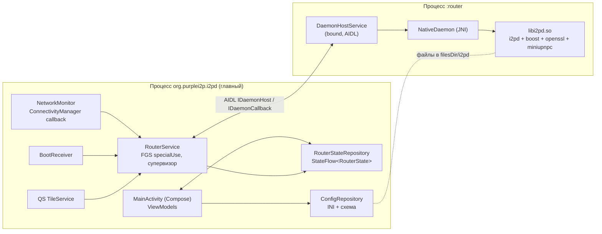
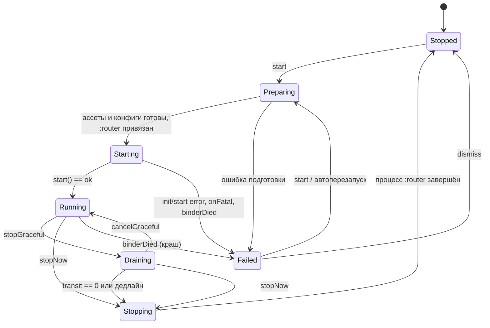

# i2pd for Android — дизайн нового приложения

Статус: черновик на согласование · Октябрь 2026

## 1. Цели и не-цели

**Цели**

1. Управление демоном i2pd через JNI: запуск, перезапуск, остановка — штатная (graceful) и быстрая.
2. Надёжная работа в фоне, в том числе после закрытия активити и удаления задачи из «недавних».
3. Графическая настройка `i2pd.conf` и туннелей (`tunnels.conf`, `tunnels.d/*.conf`) без потери комментариев и ручных правок.
4. Отображение состояния: жизненный цикл демона, сетевой статус роутера, трафик, туннели, клиентские сервисы, логи.

**Не-цели (на этом этапе)**

- VPN/`VpnService` и прозрачное проксирование трафика устройства.
- Встроенный браузер или мессенджер. Веб-консоль i2pd остаётся в WebView.
- Изменения протокола или логики роутера в самом i2pd. Правки upstream — только минимальные и только если без них никак (см. §5.6).
- Standalone-бинарник (`binary/jni`, `contrib/binary_pack`) — не трогаем, он живёт отдельно.

## 2. Платформа и ограничения

| Параметр | Значение | Комментарий |
|---|---|---|
| `minSdk` | 23 (Android 6.0) | Текущий базовый уровень AndroidX и Compose (BOM ≥ 2025.12) |
| `targetSdk` | 36 (Android 16) | |
| `compileSdk` | 37 | Требуется Compose 1.12 и свежими AndroidX. На поведение приложения не влияет, оно определяется `targetSdk` |
| build-tools | 36.0.0 | Версия по умолчанию для AGP 9.4.1 |
| Язык / UI | Kotlin, Jetpack Compose, Material 3 | Dynamic color на 31+ |
| ABI | `armeabi-v7a`, `arm64-v8a`, `x86`, `x86_64` | Сплиты по ABI + universal, как сейчас |
| NDK | актуальный LTS (r28+) | Выравнивание под страницы 16 KB по умолчанию (обязательно для target 35+) |
| Зависимости | Только AndroidX и Kotlin | Без Google Play Services и проприетарных библиотек — F-Droid |
| `applicationId` | `org.purplei2p.i2pd` | Обновление поверх старой версии, ключ подписи тот же |

Что требует target 36 и как это учитываем:

- **FGS-тип обязателен (34+).** Используем `specialUse` с `PROPERTY_SPECIAL_USE_FGS_SUBTYPE`. Почему не `dataSync`: на Android 15 у него лимит 6 часов в сутки, и его нельзя запускать из `BOOT_COMPLETED`.
- **`POST_NOTIFICATIONS` (33+)** — runtime-разрешение. Без него сервис работает, но уведомление скрыто. Просим разрешение на онбординге.
- **Edge-to-edge (35+)** и **predictive back (36)** — Compose закрывает это через `enableEdgeToEdge()` и insets.
- **`startForeground()`** вызываем сразу в `onStartCommand` с уведомлением «Запуск…», не дожидаясь демона.
- **Ограничения на старт FGS из фона (31+).** Источники старта и их статус — в §7.3.

## 3. Ключевые решения

| # | Решение | Почему |
|---|---|---|
| D1 | Демон работает в **отдельном процессе** `:router` | Глобальное состояние i2pd нельзя переинициализировать: `config::Init()` дописывает опции в глобальный `m_OptionsDesc`, `variables_map` не перезаписывается, роутер, netdb, транспорты и туннели — синглтоны с потоками. `ParseConfig` при ошибке вызывает `exit(EXIT_FAILURE)` и убивает весь процесс. Отдельный процесс даёт честный перезапуск, изоляцию падений и гарантированно быструю остановку |
| D2 | **Каждый запуск — новый процесс.** После остановки процесс `:router` завершается сам | Следствие D1: второй `Daemon.init()` в том же процессе ненадёжен |
| D3 | Супервизор — foreground-сервис в **главном процессе**. Процесс `:router` только привязан (bound) к нему | Супервизор переживает падение и перезапуск демона, держит уведомление, таймеры graceful-остановки и автоперезапуск. Привязка от FGS поднимает приоритет процесса `:router` до уровня FGS |
| D4 | Graceful-остановку реализуем сами в супервизоре | В Android-сборке i2pd graceful выключен (`#if ... !defined(ANDROID)` в `HTTPServer.cpp`) |
| D5 | Статусы — опрос нативного снимка раз в секунду в процессе `:router` и push в супервизор | Колбэков об изменениях у i2pd нет. Сам HTTP-сервер читает эти же счётчики из своего потока |
| D6 | datadir — приватный: `filesDir/i2pd`, `allowBackup=false` | Не нужны разрешения на хранилище, ключи роутера не попадают в бэкапы. Старые данные из `/sdcard/i2pd` переносим через SAF (§10.8) |
| D7 | Конфиги правим собственным **lossless INI-редактором** | Комментарии, порядок, неизвестные ключи и форматирование остаются нетронутыми. Сейчас commons-configuration2 переписывает файл целиком |
| D8 | Схема опций извлекается **из самой нативной библиотеки** (`m_OptionsDesc`) | GUI всегда соответствует версии i2pd в APK. Вручную поддерживается только UI-оверлей: метки, группировка, типы виджетов |

## 4. Архитектура процессов



- **UI и супервизор живут в одном процессе.** Они общаются напрямую через `RouterStateRepository` (`StateFlow`) и команды в `RouterController`; IPC между ними не нужен.
- **AIDL нужен только на границе** супервизор ↔ `:router`.
- **Процесс `:router` грузит только нативную библиотеку и минимум Kotlin**: никакого Compose, никаких ViewModel.
- **Удаление задачи из «недавних»** убивает активити, но не FGS. Супервизор продолжает работать и держит привязку к `:router` (подробности в §7).

## 5. Нативный слой

### 5.1. Структура

`app/jni` заменяется модулем `:native` с собственным `Android.mk` (ndk-build). Подготовка зависимостей остаётся в `binary/jni/build*.sh`, подробности в §13.

Нативные файлы:

- `jni_bridge.cpp` — регистрация методов через `RegisterNatives` в `JNI_OnLoad`. Так не нужны имена вида `Java_org_purplei2p_..._1JNI` и сгенерированный заголовок.
- `daemon_android.cpp` — обёртка над `Daemon` (`i2p::util::DaemonAndroid`): init, start, stop и сбор статуса.
- `log_sink.cpp` — `std::streambuf` для `Log::SendTo(std::shared_ptr<std::ostream>)`: кольцевой буфер строк плюс logcat в debug-сборках.
- `options_schema.cpp` — сериализация `m_OptionsDesc` в JSON (§10.3).

### 5.2. JNI API (Kotlin-сторона, `object NativeDaemon`)

```kotlin
// Вызывается один раз за жизнь процесса :router
external fun init(dataDir: String, args: Array<String>, language: String): InitResult // ok | error(message)
external fun start(): String?            // null = ok, иначе текст ошибки
external fun stop()                      // Daemon.stop(), блокирующий
external fun status(): NativeStatus      // снимок, см. §9
external fun setAcceptsTransit(accept: Boolean)
external fun reloadTunnels()             // i2p::client::context.ReloadConfig()
external fun setOnline(online: Boolean)  // i2p::transport::transports.SetOnline()
external fun readLog(sinceSeq: Long, max: Int): LogChunk
external fun setFatalHandler(cb: FatalHandler) // обёртка над i2p::log::SetThrowFunction
external fun describeOptions(): String   // JSON схемы, см. §10.3; вызывается и в главном процессе
external fun version(): String           // I2PD_VERSION
```

Аргументы при `init` формирует супервизор. Это даёт явные пути и не зависит от `DetectDataDir()`, которое на Android ищет `$EXTERNAL_STORAGE`:

```
--datadir=<filesDir>/i2pd
--conf=<datadir>/i2pd.conf
--tunconf=<datadir>/tunnels.conf
--tunnelsdir=<datadir>/tunnels.d
--certsdir=<datadir>/certificates
```

Лог-поток передаём через перегрузку `Daemon.init(argc, argv, std::shared_ptr<std::ostream> logstream)`. При непустом `logstream` i2pd игнорирует опции `log`/`logfile` и пишет только в наш поток (`Daemon.cpp`, ветка `if (logstream)`).

### 5.3. Ошибки и фатальные выходы

- **Исключения** `init`/`start` (`boost::exception`, `std::exception`, `...`) ловим на нативной стороне и возвращаем текстом, как сейчас.
- **`ThrowFatal`** (ошибка конфига, нечитаемый файл): через `SetThrowFunction` сообщение синхронно уходит в Kotlin, а оттуда oneway-вызовом `IDaemonCallback.onFatal(msg)` в супервизор. После этого i2pd вызывает `exit()`, и процесс `:router` умирает. Супервизор получает `binderDied` и уже знает причину: состояние `Failed(ConfigError(msg))`.
- **Нативный краш** (SIGSEGV и т.п.) выглядит как `binderDied` без предварительного `onFatal`: состояние `Failed(Crashed)`. Подробности есть в tombstone/logcat. В UI показываем последние строки нашего лог-буфера: супервизор периодически их забирает.

### 5.4. Остановка в нативе

`stop()` вызывает `Daemon.stop()`: клиенты, контекст, туннели, UPnP, NTP, транспорты, NetDb, HTTP, I2PControl, крипто, логгер. В процессе сохраняются профили и RouterInfo. Watchdog на Kotlin-стороне описан в §6.3.

### 5.5. Логи

- Наш `std::ostream` передаём в `Daemon.init(..., logstream)`. Строки кладём в кольцевой буфер (по умолчанию 5000 строк) с монотонным `seq`.
- Уровень берётся из `loglevel` в конфиге. В UI его можно поменять, это требует перезапуска (§10.6).
- Опции `log`/`logfile` при этом не действуют. Запись в файл `datadir/i2pd.log` с ротацией по размеру делает сам sink, если включена настройка приложения «Писать лог в файл». В GUI эти две опции скрываем.

### 5.6. Что, возможно, понадобится в upstream i2pd

- `m_OptionsDesc` не объявлен в `Config.h`, но определён как не-static. На первом этапе объявляем `extern` у себя. Корректнее добавить в upstream геттер `const options_description& GetOptionsDesc()`.
- По желанию: вынести счётчик graceful-остановки в `Daemon_Singleton`, чтобы веб-консоль на Android показывала «Graceful shutdown» и кнопку отмены. Не блокер.

## 6. Жизненный цикл демона

### 6.1. Состояния (`RouterState.lifecycle`)



`Restart` — это не отдельное состояние, а флаг `restartPending` поверх `Draining`/`Stopping`. Когда процесс доходит до `Stopped`, супервизор сразу запускает `Preparing`.

### 6.2. Запуск

1. **`RouterController.start()`** вызывает `startForegroundService(RouterService, ACTION_START)`.
2. **`RouterService`**: `startForeground(...)` с текстом «Запуск…» и переход в `Preparing`.
3. **Подготовка (IO-диспетчер):**
   - создание datadir;
   - копирование ассетов: сертификаты обновляются всегда при смене версии, конфиги копируются только если их нет (логика `assets.ready` переносится в Kotlin);
   - предварительная валидация `i2pd.conf` по схеме (§10.5), чтобы ловить ошибки до запуска.
4. **`bindService(DaemonHostService)`** с `BIND_AUTO_CREATE | BIND_IMPORTANT`, затем `linkToDeath`. Переход в `Starting`.
5. **`host.start(params)`**: в `:router` на отдельном потоке выполняются `init()` и `start()`, результат приходит в `IDaemonCallback.onStarted()` или `onStartFailed(msg)`.
6. **`Running`**: `:router` начинает раз в секунду отправлять `onStatus(snapshot)`.

### 6.3. Остановка

| Режим | Поведение | Где используется |
|---|---|---|
| **Graceful** | `setAcceptsTransit(false)` → `Draining` с дедлайном (по умолчанию 10 мин, настраивается). Каждую секунду проверяем `transitTunnels`. При 0 или по дедлайну — быстрая остановка. Отменяется через `setAcceptsTransit(true)` | Кнопка «Остановить», действие в уведомлении |
| **Быстрая** | `host.stop()`: в `:router` вызывается `Daemon.stop()`, затем `Process.killProcess(myPid())`. Супервизор держит watchdog (8 с): если `binderDied` не пришёл, убивает процесс по PID (`Process.killProcess` работает для процессов того же UID) | «Остановить сейчас», перезапуск, выход |
| **Аварийная** | Сразу `killProcess` без `Daemon.stop()` | Повторное нажатие «Остановить сейчас», зависание `stop()` |

После `Stopped` супервизор выполняет `unbindService`, `stopForeground(STOP_FOREGROUND_REMOVE)` и `stopSelf()`. Главный процесс при закрытом UI система может спокойно выгрузить.

### 6.4. Перезапуск

`restart(graceful = false)`: выставляется `restartPending = true`, затем быстрая остановка (или graceful, если пользователь выбрал её). На `Stopped` — новый `bindService`, при этом система поднимает новый процесс `:router` с чистыми глобальными переменными. FGS всё время перезапуска не снимается, уведомление показывает «Перезапуск…».

### 6.5. Падения и автоперезапуск

- `binderDied` в `Running`/`Starting` без запрошенной остановки → `Failed(Crashed | ConfigError)`.
- Если включён «Автоперезапуск» (по умолчанию да): backoff 2 с → 10 с → 60 с, не больше 3 попыток за 10 минут. `ConfigError` автоматически не перезапускаем: без правки конфига результат будет тот же.
- Система тоже может убить `:router` при нехватке памяти. Это выглядит как краш и обрабатывается так же.

## 7. Работа в фоне

### 7.1. Сервисы в манифесте

```xml
<uses-permission android:name="android.permission.FOREGROUND_SERVICE" />
<uses-permission android:name="android.permission.FOREGROUND_SERVICE_SPECIAL_USE" />
<uses-permission android:name="android.permission.POST_NOTIFICATIONS" />
<uses-permission android:name="android.permission.RECEIVE_BOOT_COMPLETED" />
<uses-permission android:name="android.permission.REQUEST_IGNORE_BATTERY_OPTIMIZATIONS" />
<uses-permission android:name="android.permission.WAKE_LOCK" />
<uses-permission android:name="android.permission.INTERNET" />
<uses-permission android:name="android.permission.ACCESS_NETWORK_STATE" />

<service android:name=".service.RouterService"
    android:exported="false"
    android:foregroundServiceType="specialUse"
    android:stopWithTask="false">
  <property android:name="android.app.PROPERTY_SPECIAL_USE_FGS_SUBTYPE"
      android:value="I2P router: relays encrypted traffic for the user and the I2P network" />
</service>

<service android:name=".daemon.DaemonHostService"
    android:exported="false"
    android:process=":router" />
```

Хранилищных разрешений нет совсем: ни `READ/WRITE_EXTERNAL_STORAGE`, ни `MANAGE_EXTERNAL_STORAGE`, ни `requestLegacyExternalStorage`.

### 7.2. Почему демон переживает «смахивание» из недавних

- `RouterService` — это FGS со `stopWithTask="false"` и `START_STICKY`. Удаление задачи вызывает у него `onTaskRemoved()`, а не остановку.
- Процесс `:router` привязан к FGS. Его importance вычисляется от клиента, то есть он тоже на уровне FGS: не замораживается cached-app freezer'ом и не выгружается раньше времени.
- Сетевые ограничения (Doze, App Standby, Data Saver, background network restrictions) применяются **к UID**, а оба процесса делят один UID. Пока у UID есть FGS, сеть доступна.
- Если система всё-таки убьёт главный процесс (`START_STICKY`): `RouterService` поднимется заново с `intent == null`. Сохранённое в `SharedPreferences` намерение `shouldRun = true` → перезапускаем демон. Процесс `:router` при этом погибнет вместе с отвязкой, и это нормально: следующий запуск всё равно идёт в новом процессе.
- **OEM-убийцы** (MIUI/HyperOS, ColorOS, EMUI, OneUI с агрессивной оптимизацией): на онбординге и в настройках предлагаем снять оптимизацию батареи (`ACTION_REQUEST_IGNORE_BATTERY_OPTIMIZATIONS`) и даём ссылки на OEM-экраны автозапуска (как сейчас в `SettingsActivity`, но с исправленным сравнением производителя) плюс dontkillmyapp.com.

### 7.3. Источники запуска

| Источник | Как стартует FGS | Разрешено на 31+ |
|---|---|---|
| Кнопка в UI | `startForegroundService` из активити на переднем плане | Да |
| Действие в уведомлении | `PendingIntent.getForegroundService` | Да (исключение для действий пользователя с уведомлением) |
| `BOOT_COMPLETED` | `startForegroundService` из `BootReceiver` | Да, для `specialUse` (запрет на Android 15 касается только `dataSync`, `camera`, `mediaPlayback` и некоторых других типов) |
| Плитка QS | `TileService.onClick` | **Проверить на 34+.** Запасной вариант — `startActivityAndCollapse(PendingIntent)` на прозрачную trampoline-активити, которая запускает сервис |
| START_STICKY-перезапуск | система | Да |

Автозапуск при загрузке включается настройкой `autostartOnBoot`, которая хранится в DataStore, а не в файле-флаге в `cacheDir`.

### 7.4. Wakelock

Без partial wakelock в глубоком сне CPU останавливается: таймеры роутера замирают, транзитные туннели рвутся. Поэтому:

- Настройка «Не давать устройству засыпать», по умолчанию **выкл**. Включение показывает предупреждение о расходе батареи. Wakelock держит супервизор, пока демон в `Running`/`Draining`.
- Отдельно — «Только при зарядке».

### 7.5. Сеть

`NetworkMonitor` в супервизоре: `registerDefaultNetworkCallback` (24+) или `registerNetworkCallback` (23). Изменения пробрасываются в `host.setOnline()` с дебаунсом 2 с. Старый манифест-ресивер на `CONNECTIVITY_CHANGE` удаляется: с Android 7 он не получает события.

### 7.6. Уведомление

- **Канал** «Состояние роутера», `IMPORTANCE_LOW`, без звука.
- **Заголовок** — состояние жизненного цикла; **текст** — `Сеть: OK (v4) · ↓ 12 KB/s ↑ 8 KB/s · транзит 34`.
- **Обновление** — не чаще раза в 5 с и только при изменении текста.
- **Действия:** «Остановить» (graceful), «Сейчас» (fast), «Перезапуск». В `Draining`: «Отменить» и «Сейчас».
- **Тап** открывает `MainActivity`.

## 8. IPC (AIDL)

```aidl
// :router реализует
interface IDaemonHost {
    void registerCallback(IDaemonCallback cb);
    oneway void start(in StartParams params);
    oneway void stop();                       // Daemon.stop() + exit процесса
    void setAcceptsTransit(boolean accept);
    oneway void reloadTunnels();
    oneway void setOnline(boolean online);
    StatusSnapshot getStatus();
    LogChunk readLog(long sinceSeq, int max);
    String describeOptions();                 // при необходимости; основной путь — §10.3
}

// супервизор реализует
oneway interface IDaemonCallback {
    void onStarted(String version);
    void onStartFailed(String message);
    void onFatal(String message);
    void onStatus(in StatusSnapshot s);
}
```

`StatusSnapshot`, `StartParams` и `LogChunk` — классы с `@Parcelize` в общем модуле `:daemon-api`.

## 9. Статусы

### 9.1. `StatusSnapshot` (из натива, раз в секунду)

| Поле | Источник в i2pd |
|---|---|
| `routerStatusV4`, `routerStatusV6` | `context.GetStatus()` / `GetStatusV6()`: OK, Firewalled, Unknown, Proxy, Mesh, Stan |
| `routerErrorV4`, `routerErrorV6` | `context.GetError()` / `GetErrorV6()`: ClockSkew, Offline, SymmetricNAT, FullConeNAT, NoDescriptors |
| `testingV4`, `testingV6` | `context.GetTesting()` / `GetTestingV6()` |
| `uptimeSec` | `context.GetUptime()` |
| `acceptsTransit`, `floodfill` | `context.AcceptsTunnels()`, `IsFloodfill()` |
| `bwIn`, `bwOut`, `bwTransit` (15 с) | `transports.GetIn/Out/TransitBandwidth15s()` |
| `totalRx`, `totalTx`, `totalTransit` | `transports.GetTotalReceivedBytes()`… |
| `tunnelsIn`, `tunnelsOut`, `transitTunnels` | `tunnels.CountInbound/Outbound/TransitTunnels()` |
| `tunnelSuccessRate` | `tunnels.GetTunnelCreationSuccessRate()` |
| `routers`, `floodfills`, `leaseSets` | `netdb.GetNumRouters/Floodfills/LeaseSets()` |
| `services` | `client::context.GetHttpProxy/GetSocksProxy/GetSAMBridge/GetBOBCommandChannel/GetI2CPServer()` + адрес и порт из конфига |
| `webConsoleUrl` | `http.address`, `http.port` |
| `netId`, `version` | `context.GetNetID()`, `I2PD_VERSION` |

Объект создаём через JNI один раз за тик: `NewObject` с закешированными `jmethodID`.

### 9.2. `RouterState` (в главном процессе)

```kotlin
data class RouterState(
    val lifecycle: Lifecycle,          // Stopped | Preparing | Starting | Running | Draining(deadline) | Stopping | Failed(reason)
    val restartPending: Boolean,
    val status: StatusSnapshot?,       // последний снимок, null если демон не запущен
    val pendingRestartReasons: Set<String>, // изменённые опции, требующие перезапуска (§10.6)
)
```

Когда никого нет (UI закрыт, а уведомлению хватает текста), частоту опроса можно снизить до 5 с: супервизор передаёт `setStatusInterval()`. Это оптимизация, не обязательная для первой версии.

## 10. Система конфигурации

### 10.1. Файлы в datadir

```
filesDir/i2pd/
  i2pd.conf            ← правит GUI
  tunnels.conf         ← правит GUI
  tunnels.d/*.conf     ← правит GUI; файлы из ассетов (Telegram, IRC) копируются один раз
  certificates/        ← из ассетов, обновляется при смене версии
  addressbook/ netDb/ peerProfiles/ router.keys router.info *.dat ...
```

Настройки самого приложения (автозапуск, wakelock, таймаут graceful, автоперезапуск, тема) хранятся в DataStore, а не в `i2pd.conf`.

### 10.2. Lossless INI

Модуль `:config` — чистый Kotlin/JVM, полностью покрывается unit-тестами.

- **Модель** `IniDocument`: список строк-узлов `Comment | Blank | Section(name) | Entry(key, value, rawLine) | Unknown(raw)`. Глобальная секция (до первого `[...]`) — это секция с именем `""`.
- **Чтение** не нормализует ничего, кроме концов строк. Запись выводит те же узлы. Изменённый `Entry` переписывается в формате `key = value`, отступы и комментарий в конце строки сохраняются.
- **API:** `get(section, key)`, `set(section, key, value)` (создаёт секцию или ключ в конце соответствующей секции), `remove(section, key)` (удаляет строку или по выбору комментирует её `# key = value`), `sections()`, `addSection()`, `removeSection()`, `renameSection()`.
- **Соответствие опциям i2pd:** `[http] port = 7070` ↔ `http.port`. Ключи с точкой внутри секции (`inbound.length` в `[httpproxy]`) дают опцию `httpproxy.inbound.length`. Разбиение — по первой точке.
- **Значение по умолчанию.** Если значение совпадает с дефолтом схемы и ключа в файле не было, ключ не записываем: файл остаётся компактным.
- **Атомарная запись:** `tmp` → `fsync` → `rename`, перед первым изменением сессии делаем бэкап `i2pd.conf.bak`.
- **Многозначные ключи** (в boost это `composing`, у i2pd почти не встречаются) сохраняются как есть.

### 10.3. Схема опций из нативной библиотеки

- **`describeOptions()`** обходит `m_OptionsDesc.options()` и возвращает JSON:
  ```json
  {"version":"2.61.0","options":[
    {"name":"http.port","section":"http","key":"port","type":"uint16","default":"7070",
     "description":"Web Console port"}
  ]}
  ```
- **Тип** определяется по `semantic()->apply_default(boost::any&)` и `any.type()`: `bool`, `std::string`, `uint16_t`, `uint32_t`, `int`, `uint64_t`, `double`. Опции без дефолта получают тип `string`.
- **Где вызывается.** В **главном процессе** (`System.loadLibrary` + `config::Init()`, роутер не запускается). Результат кешируется в `filesDir/schema-<версия>.json`, поэтому библиотека грузится в главный процесс один раз на версию приложения.
- **Почему не в `:router`.** Повторный `config::Init()` перед `Daemon.init()` сломает запуск (D1).
- **Модули, которых нет в Android-сборке** (`unix.*`, `openbsd.*`, `daemon`, `service`, `pidfile`), прячет оверлей.

### 10.4. UI-оверлей (вручную, в Kotlin)

`OptionUi(name, group, level = Basic|Advanced|Hidden, widget, labelRes, summaryRes, requiresRestart = true)`.

- **Виджеты:** `Switch`, `Port`, `Number(min, max)`, `Text`, `Enum(values)` (`loglevel`: none/critical/error/warn/info/debug; `bandwidth`: L/O/P/X или число КБ/с), `HostOrIp`, `FilePath(datadir-relative)`.
- **Basic** — примерно 25 опций: сеть (`ipv4`, `ipv6`, `bandwidth`, `share`, `notransit`, `floodfill`), транспорты (`ntcp2.enabled`, `ssu2.enabled`, `upnp.enabled`), прокси (`httpproxy.*`, `socksproxy.*`: enabled, address, port, outproxy), веб-консоль (`http.*`), SAM, I2CP, `loglevel`, `limits.transittunnels`, `persist.profiles`.
- **Advanced** — все остальные опции из схемы, сгруппированные по секциям. Метка = имя опции, подпись = описание из boost (англ.).
- **Опции, которых нет в оверлее,** автоматически попадают в Advanced. Новые опции из свежего i2pd появляются в GUI без правок кода.
- **Переводы:** строки оверлея лежат в `strings.xml`, существующие переводы переносим.

### 10.5. Валидация

- **По типу и диапазону** из схемы и оверлея (порт 1..65535, числа, enum).
- **Неизвестный ключ** в `i2pd.conf` — ошибка. i2pd вызывает `parse_config_file` без `allow_unregistered`, значит неизвестный ключ = `exit()` при старте. GUI показывает такие ключи с действием «удалить/закомментировать».
- **Кросс-проверки:** конфликт портов между `http`, `httpproxy`, `socksproxy`, `sam`, `i2cp`, `i2pcontrol` и клиентскими туннелями; порты < 1024 не разрешены для непривилегированного приложения.
- **Перед стартом** валидация запускается повторно (§6.2). Если есть ошибки, состояние `Failed(ConfigError)` и ссылка на нужный экран настроек.

### 10.6. Применение изменений

| Что изменено | Как применяется |
|---|---|
| `i2pd.conf` (любая опция) | Сохраняем файл, в `RouterState` появляется баннер «Требуется перезапуск» → кнопка «Перезапустить» (§6.4) |
| `tunnels.conf`, `tunnels.d/*` | `reloadTunnels()` без перезапуска (`ClientContext::ReloadConfig`) |
| «Принимать транзит» | Сразу через `setAcceptsTransit()`, плюс по выбору сохраняем `notransit` в конфиг |
| Настройки приложения | Сразу |

### 10.7. Редактор туннелей

- **Список** — все секции из `tunnels.conf` и `tunnels.d/*.conf`. Для каждой видно файл-источник, тип, адрес и порт, назначение или ключи и статус (поднят ли туннель — `ClientContext::GetClientTunnels/GetServerTunnels`, добавить в снимок по запросу).
- **Форма** зависит от `type`: `client`, `server`, `http`, `irc`, `udpclient`, `udpserver`, `socks`, `httpproxy`, `websocks`. Поля берутся из констант `ClientContext.h` (`port`, `address`, `destination`, `destinationport`, `keys`, `signaturetype`, `cryptotype`, `host`, `inport`, `accesslist`, `whitelist`, `gzip`, `hostoverride`, `i2pheaders`, `ssl`, `webircpassword`…) и параметров I2CP (`inbound.length`, `inbound.quantity`, `outbound.*`, `i2cp.leaseSetType`, `i2cp.leaseSetEncType`…).
- **Схемы туннелей в `m_OptionsDesc` нет**, поэтому описываем её вручную в оверлее. Неизвестные ключи сохраняем и показываем в разделе «Прочие параметры».
- **Новые туннели** пишутся в `tunnels.d/<name>.conf`. Существующие правятся в своём файле.
- **Действия:** включить или выключить туннель (переносим файл в `tunnels.d/disabled/` или комментируем секцию — решить при реализации), скопировать адрес `.b32.i2p` сервер-туннеля (нужен JNI-вызов: ключи → b32), поделиться.

### 10.8. Ручной редактор, импорт/экспорт, миграция

- **Ручной редактор:** простой текстовый редактор каждого файла с подсветкой секций и валидацией при сохранении. Это запасной путь для опытных пользователей.
- **Экспорт и импорт:** zip через SAF (`ACTION_CREATE_DOCUMENT` / `ACTION_OPEN_DOCUMENT`). Внутри конфиги, `tunnels.d`, ключи (`router.keys`, `*.dat`), адресная книга. netDb и профили — по выбору.
- **Миграция со старой версии (`/sdcard/i2pd`):**
  1. При первом запуске новой версии datadir пуст. Онбординг предлагает «Перенести данные из прежней версии».
  2. `ACTION_OPEN_DOCUMENT_TREE` с подсказкой на `primary:i2pd`: пользователь выбирает папку, и мы копируем через `DocumentFile`. Разрешения на хранилище не нужны ни на одной версии Android.
  3. Копируем: `i2pd.conf`, `tunnels.conf`, `tunnels.d/`, `router.keys`, `router.info`, `*.dat`, `addressbook/`. netDb — по выбору: так быстрее старт, но можно и пересидировать.
  4. После копирования валидируем `i2pd.conf` по схеме. Устаревшие ключи (например `ssu`, если его уберут) предлагаем удалить.
  5. Отказ от миграции = чистая установка с конфигами из ассетов.

## 11. UI (Compose)

Навигация: нижняя панель «Статус · Туннели · Настройки · Логи», дополнительные экраны открываются поверх.

1. **Статус**
   - Большая карточка состояния (жизненный цикл + сетевой статус v4/v6 с понятным текстом ошибки).
   - Кнопки «Запустить», «Остановить» (меню: штатно/сейчас) и «Перезапустить».
   - В `Draining` — таймер, число оставшихся транзитных туннелей, «Отменить» и «Сейчас».
   - Метрики: аптайм, скорость ↓↑ и транзита со спарклайном за последние 5 минут (буфер в репозитории), трафик всего, туннели входящие/исходящие/транзит, успешность создания туннелей, роутеры/floodfill/leaseset.
   - Чипы сервисов: «HTTP-прокси 127.0.0.1:4444» и т.п. Тап копирует адрес, длинный тап — переход к настройке.
   - Баннеры: «Требуется перезапуск», «Оптимизация батареи включена», «Уведомления выключены», ошибка конфигурации.
   - Кнопка «Веб-консоль».
2. **Туннели** — список, добавление, редактирование, удаление, «Применить» (`reloadTunnels`).
3. **Настройки:**
   - **Роутер:** Basic-группы, раздел «Расширенные» (вся схема) с поиском по имени и описанию, «Редактировать файл вручную».
   - **Приложение:** автозапуск, автоперезапуск, таймаут graceful, wakelock, тема, оптимизация батареи, OEM-автозапуск.
   - **Данные:** экспорт, импорт, миграция, «Сбросить конфиг к умолчаниям».
   - **О приложении:** версия i2pd и приложения, ABI, лицензии.
4. **Логи** — живой вывод из кольцевого буфера с фильтром по уровню и поиском, «Поделиться» (текстовый файл через `FileProvider`), «Очистить».
5. **Веб-консоль** — WebView на `webConsoleUrl`: только loopback, без JS-интерфейсов, `MetricsOptOut`. Без cleartext-разрешения на весь трафик: `network_security_config` разрешает cleartext только для `127.0.0.1`/`localhost`.
6. **Онбординг** (первый запуск) — что такое i2pd, разрешение на уведомления, оптимизация батареи, миграция, «Запустить».

**Плитка QS:** состояние Active/Inactive/Unavailable по `RouterState`, тап — старт или graceful-стоп.

## 12. Модули

```
:app            Compose UI, навигация, ViewModels, онбординг, MainActivity
:service        RouterService (супервизор), RouterController, RouterStateRepository,
                NetworkMonitor, BootReceiver, TileService, уведомления, AppSettings (DataStore)
:daemon-api     AIDL, Parcelable-модели (StatusSnapshot, StartParams, LogChunk)
:daemon         DaemonHostService (:router), NativeDaemon (JNI-обёртка)
:native         C++ JNI-мост, сборка libi2pd.so (ndk-build/CMake), ссылки на binary/jni
:config         Lossless INI, модель схемы, оверлей, валидация, ConfigRepository — JVM-модуль
```

DI — вручную: `AppContainer` в `Application`. Hilt для такого объёма избыточен и тянет kapt/ksp.

## 13. Сборка и CI

- **Gradle:** актуальные стабильные AGP/Kotlin/Compose на момент начала работы, версии зафиксированы в `gradle/libs.versions.toml`. JDK 17+.
- **Нативные скрипты** `binary/jni/build_*.sh`: `API=23`, NDK r29. OpenSSL и miniupnpc собираются из сабмодулей, результат кешируется по stamp-файлу (ревизия NDK + API).
- **Boost:** Boost-for-Android (поддерживает NDK только до 27.0) убран. `build_boost.sh` скачивает релизный тарбол с проверкой sha256, а `program_options`, `json` и `url` компилируются прямо в ndk-build (`binary/jni/deps.mk`).
- **i2pd ≥ 3.0** требует C++20: `-std=c++20` в обоих `Application.mk`.
- **`binary/jni/deps.mk`** — общие определения модулей и списка исходников i2pd для приложения (`native/jni/Android.mk`) и standalone-бинарника (`binary/jni/Android.mk`).
- **Флаги:** `-Wl,-z,max-page-size=16384` явно (на r28+ уже по умолчанию), `APP_STL := c++_static`, `-fvisibility=hidden` плюс экспорт только `JNI_OnLoad`.
- **Подпись:** конфиг release-подписи берётся из `keystore.properties` или переменных окружения, а не из `build.gradle`.
- **CI:**
  - исправить переключение JDK: `actions/setup-java` вместо `export` в отдельном шаге;
  - кешировать собранные библиотеки (`binary/jni/*/out`) по хешу сабмодулей;
  - unit-тесты `:config` и lint;
  - instrumented-тесты на эмуляторе — отдельным job'ом, по ручному запуску.
- **F-Droid:** без изменений в метаданных, кроме `minSdk`. Сборка должна оставаться воспроизводимой.

## 14. Тестирование

- **`:config`** (JUnit):
  - круговой тест чтение → запись = исходный файл на наборе реальных конфигов (ассеты, старые пользовательские, с комментариями, CRLF, BOM);
  - set/remove;
  - соответствие секций и опций;
  - валидация и конфликты портов.
- **`:native`:** smoke-тест `describeOptions()` — JSON парсится, есть ключевые опции, типы распознаны.
- **`:service`** (Robolectric или instrumented):
  - переходы стейт-машины на фейковом `IDaemonHost`: старт, ошибка, `onFatal` → `binderDied`, краш с backoff, graceful с отменой, перезапуск, watchdog быстрой остановки.
- **Ручной чек-лист на устройствах** (Android 6, 10, 13, 14, 15, 16 и один MIUI/HyperOS):
  - смахивание из недавних — демон жив 1 ч, туннели работают;
  - перезагрузка с автозапуском;
  - смена сети Wi-Fi ↔ LTE;
  - быстрая остановка < 10 с, graceful < дедлайна;
  - битый конфиг → понятная ошибка;
  - миграция со старой версии.

## 15. Этапы реализации

1. **Каркас:** новые модули, Gradle-обвязка, minSdk 23/target 36, сборка `libi2pd.so` с новым NDK, CI.
2. **Демон и процессы:** `:native` JNI-мост, `DaemonHostService` в `:router`, AIDL, `RouterService` со стейт-машиной, уведомление. Минимальный экран статуса со старт/стоп/перезапуском. → Здесь проверяем фоновую работу и остановку на устройствах.
3. **Статусы и логи:** полный `StatusSnapshot`, экран статуса, логи, плитка QS, автозапуск, сеть.
4. **Конфигурация:** `:config` (INI + схема + оверлей + валидация), экраны настроек Basic/Advanced/ручной редактор, баннер перезапуска.
5. **Туннели:** редактор туннелей, `reloadTunnels`.
6. **Данные:** онбординг, миграция с `/sdcard/i2pd`, экспорт/импорт.
7. **Полировка:** переводы, доступность, тёмная тема, планшеты, удаление старого кода. На этапе 1 он перенесён в `legacy/` и в сборку не входит.

## 16. Открытые вопросы

1. Запуск FGS из `TileService.onClick` на 34+ — проверить на устройстве, иначе trampoline-активити.
2. Отключение туннеля: перенос файла в `tunnels.d/disabled/` или комментирование секции?
3. Нужен ли «Режим только клиента» как пресет (`notransit = true`, `bandwidth = L`, без wakelock) для экономии батареи?
4. Изменить ли дефолтный `loglevel` с `none` на `warn`, чтобы экран логов был полезен из коробки?
5. Апстримить ли в i2pd геттер `GetOptionsDesc()` и поддержку graceful для Android-сборки (§5.6)?
